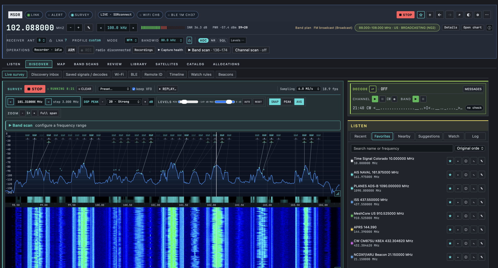

<h1 align="center">msdr</h1>

<p align="center"><strong>Signal discovery, decoding and listening tools for SDRconnect.</strong> </p>

<p align="center">
  <a href="https://github.com/gdamdam/msdr/actions/workflows/ci.yml"></a>
  
  <a href="LICENSE"></a>
</p>



msdr runs alongside SDRconnect and connects through its WebSocket API. No build step.

- **Discover and decode** signals, track satellites
- **Keep a journal** of what you hear, and save receiver setups to return to
- **Passive Wi-Fi, BLE and drone Remote ID**, with separate hardware, not the SDR ([Optional software](#optional-software))

Every label shows its source: DSP measurement, decoded payload, schedule, band allocation or your note. A schedule or band-plan match is a hint, not proof of reception. Levels are relative, not calibrated. msdr never transmits.

Tested on macOS with SDRconnect 1.0.10 and an RSPdx-R2.

## Quick start

**Requirements:** Python 3.11+, SDRconnect 1.0.9+ (WebSocket API 1.0.3), macOS. Windows and Linux are untested.

1. In SDRconnect, enable **Primary SP “…” → Preferences → WebSocket Server** on port `5454`.
2. Clone, install and start msdr:

   ```sh
   git clone https://github.com/gdamdam/msdr && cd msdr
   pip install .        # or: pipx install .
   msdr
   ```

3. Open [127.0.0.1:8765](http://127.0.0.1:8765) and press **Play** in SDRconnect.
4. Follow the **Getting Started** checklist at the top of the page. Press **S** to save the current receiver state, or **Cmd/Ctrl-K** to search and tune.

`msdr --no-browser` runs it headless. Your library stays browsable and editable while SDRconnect is closed.

### Optional software

msdr runs with SDRconnect alone. Each item below only switches on the feature named; the app shows it as *missing*, with an install hint, until it is found. Command-line tools are looked up on `PATH` and in `~/.local/bin`.

| For | Install |
|---|---|
| POCSAG, FLEX, EAS, APRS 1200/9600, DTMF, CW | `multimon-ng`: build from [source](https://github.com/EliasOenal/multimon-ng), copy to `~/.local/bin` |
| AX.25 300 baud packet | `brew install direwolf` |
| RTTY cross-check | `brew install minimodem` (the built-in RTTY decoder needs nothing) |
| DMR, P25, NXDN, D-STAR, YSF, dPMR, M17 | `dsd-fme`: build from source (mbelib, itpp, libsndfile, ncurses from Homebrew), copy to `~/.local/bin` |
| FT8 | [WSJT-X](https://wsjt.sourceforge.io/wsjtx.html) (`jt9` on `PATH` or inside `wsjtx.app`) |
| Wi-Fi networks | An ALFA AWUS036ACH and the `msdr-wifi-capture` helper: [docs/wifi.md](docs/wifi.md) |
| BLE advertisements | A Bluetooth 4 USB dongle (`brew install libusb`) or a SONOFF ZBDongle-P with Sniffle firmware, plus `pip install '.[ble]'`: [docs/ble.md](docs/ble.md) |
| Satellite passes | [nextpass](https://github.com/gdamdam/nextpass): `pip install git+https://github.com/gdamdam/nextpass` |
| IQ recording analysis | [iqscan](https://github.com/gdamdam/iqscan): `pip install git+https://github.com/gdamdam/iqscan` |
| JS8Call, Winlink, FreeDATA messages | The JS8Call, Pat or FreeDATA application, running (Setup → Integrations) |

Built in, nothing to install: LoRa (Meshtastic and MeshCore headers), ADS-B / Mode S, AIS, RS41 radiosondes, DSC, WEFAX, SSTV, NAVTEX, RTTY, WWV/DCF77/MSF time codes, End-of-Train, VOR and ILS.

## Features

msdr is organised into nine workspaces.

| Workspace | What it does |
|---|---|
| **Listen** | Live survey beside the Listen panel (recent, favourites, nearby, suggestions, channel watch, log), decode deck, IQ recording, antenna and mode locks. |
| **Discover** | Live survey, Discovery inbox, saved signals and decodes, Wi-Fi, BLE, Remote ID, Timeline, watch rules and NCDXF/NDB beacons. |
| **Map** | Aircraft, vessels, radiosondes, APRS and DSC traffic with a position. |
| **Band scans** | The list of range scans with each report: coverage, findings, session comparisons and exports. |
| **Review** | Recordings, replay, Scope, messages and observations. |
| **Satellites** | Pass predictions, sky tracks and Doppler tracking. |
| **Library** | Memories, profiles, notes, tags, lists, favourites, recordings and tune history. |
| **Catalog** | Imported station schedules and reference directories: search, on-air first, sort by frequency, time, name or distance, tune. |
| **Allocations** | The US Table of Frequency Allocations as a zoomable chart and list. |

A few things that are less common elsewhere:

- Channel watch follows a list of frequencies and captures activity with a pre-roll IQ recorder, so the start of a burst is on disk before you press record.
- Band scans keep a report of what was found and what was actually covered, so a quiet frequency and an unscanned one are not confused.
- Any saved signal can be exported as an evidence ZIP: observations, claims, decoder versions, notes and a short IQ clip when one exists.

The [user guide](docs/user-guide.md) covers every workspace in detail.

## Decoders

Raw-IQ decoders (ADS-B / Mode S, RS41, FT8, DSC, End-of-Train, VOR, ILS, LoRa) run on the live channel and on recordings in Review. Audio decoders run beside them, including Radiofax (WEFAX) and SSTV. Open **Decode setup (⚙)** to pick decoders; **Messages** shows the decoded history.

A decoder shows *Ready* when its code or tool is installed. That does not mean it has been validated on real signals; see [decoder scope and evidence](docs/decoder-expansion.md).

**Lawful use.** msdr is receive-only: it never transmits, and its Wi-Fi and BLE features only listen to frames that devices broadcast. Laws on monitoring radio traffic, and on recording or disclosing what is received, differ by country and by service (for example pager, land-mobile and digital-voice systems). You are responsible for complying with the law where you operate.

Per-decoder notes: [ADS-B](docs/adsb-native.md) · [LoRa / mesh](docs/lora-native.md) · [FT8](docs/ft8.md) · [RS41](docs/rs41.md) · [DSC](docs/dsc.md) · [SSTV](docs/sstv.md) · [user guide → Decoders](docs/user-guide.md#decoders)

## Configuration

- **Data and settings** live in `~/Library/Application Support/msdr/`.
- **CLI flags:** `--host` (SDRconnect host), `--port`, `--web-port`, `--db`, `--settings`, `--no-browser`. See `msdr --help`.
- **Access:** the web UI listens on `127.0.0.1` only.
- **Live data** needs SDRconnect playing. Satellite features need your location and orbital elements (**↻ TLE** in the app).
- **Device history** (Wi-Fi/BLE) is off by default; enable it with `"history": {"enabled": true}` in `settings.json`.
- **Theme:** the ◐ button in the instrument strip cycles Default, Midnight, Blueprint, Avionics and Monochrome (remembered per browser).

<details>
<summary><strong>Keyboard shortcuts</strong></summary>

| Key | Action |
|---|---|
| `Cmd/Ctrl-K` | Search and tune |
| `Cmd/Ctrl-Z` | Undo settings, tuning and library edits |
| `Cmd/Ctrl-Shift-Z` | Redo the last undone change |
| `S` | Save current receiver state |
| `Cmd/Ctrl-[` / `Cmd/Ctrl-]` | Back / Forward |
| `E` / `I` | Edit memory / identify |
| `F` | Edit VFO frequency |
| `R` | Start or stop pre-roll recording |
| `←` / `→` | Step VFO; Shift for ×10, Alt for ×0.1 |
| `,` | Open Setup |
| `Esc` | Close palette, drawer or frequency editor |

Frequency input accepts `137.9`, `137900k`, or `14.230 MHz`.

</details>

## Docs

- [User guide](docs/user-guide.md): every feature in detail
- [Catalog sources](docs/catalogs.md) · [Reference catalogs](docs/reference-catalogs.md) · [Frequency allocations](docs/allocations.md)
- [Passive Wi-Fi](docs/wifi.md) · [Passive BLE](docs/ble.md) · [Device history and timeline](docs/history.md) · [Remote ID](docs/remote-id.md)
- [Integrations: JS8Call, Winlink, FreeDATA](docs/integrations.md) · [Receiver DSP](docs/receiver-dsp.md) · [Discover map](docs/discover-map.md)
- [Optional RF ML](docs/rf-ml.md) (currently disabled)

## Development

```sh
python3 -m venv .venv
.venv/bin/pip install -e ".[dev]"
.venv/bin/python scripts/dev_fake.py      # fake receiver on port 5455
.venv/bin/msdr --port 5455                # in another terminal
.venv/bin/pytest -q -W error && .venv/bin/ruff check msdr tests scripts
```

One Python process: a `RadioAdapter` boundary to the receiver, SQLite storage with numbered migrations, a FastAPI backend and a no-build Lit UI. Design notes live in `docs/`.

## How it's built

msdr is a free, non-commercial project, built out of love for radio. It was developed with AI coding tools; every change was designed, reviewed and tested by a human, on real hardware (RSPdx-R2).

## Credits and license

msdr's original code is licensed under [GPL-3.0-only](LICENSE). Third-party code, models and data keep their own terms; see [THIRD_PARTY_NOTICES.md](THIRD_PARTY_NOTICES.md).

**Receiver and platform**
- SDRplay's SDRconnect WebSocket API (the receiver msdr drives).
- Python dependencies: FastAPI, Uvicorn, websockets, Pydantic, Skyfield and NumPy; optional PyTorch, timm and Ultralytics for RF ML.

**Bundled code**
- [Lit](https://github.com/lit/lit) 3.2.1 (BSD-3-Clause) and [Leaflet](https://leafletjs.com/) 1.9.4 (BSD-2-Clause) in the UI.
- Decoder and demodulator code adapted from [SDRangel](https://github.com/f4exb/sdrangel) and [gr-lora_sdr](https://github.com/tapparelj/gr-lora_sdr) (GPL-3.0); authors and details in [THIRD_PARTY_NOTICES.md](THIRD_PARTY_NOTICES.md).
- RF classifier architecture from TorchSig's XCiT model, with code derived from [timm](https://github.com/huggingface/pytorch-image-models) (Apache-2.0).

**Separately installed tools (not bundled)**
- Decoders: WSJT-X `jt9`, `multimon-ng`, `minimodem`, `direwolf`, `dsd-fme`; FlightAware `dump1090-fa` as an alternative ADS-B backend in the code (the built-in decoder is the default).
- Satellite passes: `nextpass`; IQ analysis: `iqscan`.
- Passive Wi-Fi: the [rtl8812au-macos](https://github.com/xen-proc/rtl8812au-macos) userspace driver (GPL-2.0-only, derived from aircrack-ng/rtl8812au and Realtek code), run as its own program; msdr only reads its PCAP output.
- Optional RF ML weights from TorchSig and TorchDSP, downloaded on request.

**Data**
- Orbital elements: [CelesTrak](https://celestrak.org/). Map tiles: © [OpenStreetMap](https://www.openstreetmap.org/copyright) contributors.
- Frequency allocations: [NTIA Table of Frequency Allocations](https://redbook.ntia.gov/) and [47 CFR §2.106](https://www.ecfr.gov/current/title-47/chapter-I/subchapter-A/part-2/subpart-B/section-2.106) (US government works).
- Broadcast and signal catalogs: EiBi, HFCC, Aoki, NDXC, NOAA radiofax, SigIDWiki, Priyom and SatNOGS, under each source's terms.
- Reference catalogs: NIST time stations, FAA NASR navaids, IOOS HFRNet radar sites and SuperDARN radar hardware tables (identifiers and locations only; SuperDARN data use is governed by its PI agreement).
- Test fixtures: "SSTV sunset audio" by Mysid, [CC BY 2.5](https://creativecommons.org/licenses/by/2.5), via Wikimedia Commons.
- SSTV mode timings follow JL Barber (N7CXI), "Proposal for SSTV Mode Specifications" (2000).
